<div align="center">


<br/>

<a href="https://linkedin.com/in/sifat-noor-siam-953650206"></a>
<a href="mailto:sifatabir2001@gmail.com"></a>
<a href="https://my-portfolio-nu-sandy-55.vercel.app"></a>
<a href="https://drive.google.com/file/d/17pcdI5UCVv8uemP1IxGQ7ujlIaFsx4dI/view?usp=sharing"></a>
<a href="https://github.com/fragliglint"></a>


</div>

<br/>


```python
from dataclasses import dataclass, field


@dataclass
class SifatNoorSiam:
    name: str = "Sifat Noor Siam"
    roles: tuple = ("Full-Stack Developer", "ML Engineer", "AI Researcher")
    location: str = "Dhaka, Bangladesh"
    education: str = "B.Sc. CSE @ East West University"
    working_at: str = "CeylonZtudio"

    focus: list = field(default_factory=lambda: [
        "Full-Stack Web & Mobile",    # Next.js · React Native · Laravel · Flutter · Node.js 
        "Machine Learning",   # SimCLR · MoCo · BYOL · DINO · SwAV · Barlow Twins · VICReg · SimSiam · MAE · CLIP · Linear Regression · Polynomial Regression                                    # Ridge Regression · Lasso Regression · Elastic Net Regression · Bayesian Linear Regression · Logistic Regression · SVM · U-Net
                              # Decision Tree · Random Forest · XGBoost · LightGBM · CatBoost · KNN · Naive Bayes · MLP · CNN · ResNet · Vision Transformer (ViT)  
        "Computer Vision & YOLO",     # real-time detection & navigation
        "Data-Driven Systems",        # turning data & analytics into decisions
    ])

    philosophy: str = (
        "Bridging clean UI with solid backend logic and deploying "
        "end-to-end ML systems that solve real-world problems."
    )

    def ship(self, solution):
        return solution.build().train().serve(api="Laravel").wrap(ui="Next.js")
```

<br/>


<br/>



<br/>



<br/>


<table>
<tr>
<td width="150" valign="top"><b>🤖 AI / ML</b></td>
<td>
<br/>


</td>
</tr>
<tr>
<td valign="top"><b>📊 Data</b></td>
<td>
<br/>


</td>
</tr>
<tr>
<td valign="top"><b>💬 Languages</b></td>
<td></td>
</tr>
<tr>
<td valign="top"><b>🔌 Backend</b></td>
<td>


</td>
</tr>
<tr>
<td valign="top"><b>🎨 Frontend & Mobile</b></td>
<td></td>
</tr>
<tr>
<td valign="top"><b>🗄️ Databases</b></td>
<td></td>
</tr>
<tr>
<td valign="top"><b>☁️ Tools & Deploy</b></td>
<td></td>
</tr>
</table>

<br/>


<div align="center">


</div>

<br/>


<div align="center">

<picture>
  <source media="(prefers-color-scheme: dark)" srcset="https://raw.githubusercontent.com/fragliglint/fragliglint/output/github-snake-dark.svg"/>
  <source media="(prefers-color-scheme: light)" srcset="https://raw.githubusercontent.com/fragliglint/fragliglint/output/github-snake.svg"/>
  
</picture>

</div>

<br/>


<br/>

<a href="mailto:sifatabir2001@gmail.com"></a>

<div align="center">

<a href="mailto:sifatabir2001@gmail.com"></a>
<a href="https://linkedin.com/in/sifat-noor-siam-953650206"></a>
<a href="https://my-portfolio-nu-sandy-55.vercel.app"></a>

<sub><i>Turning data into decisions, building systems that ship.</i></sub>


</div>
